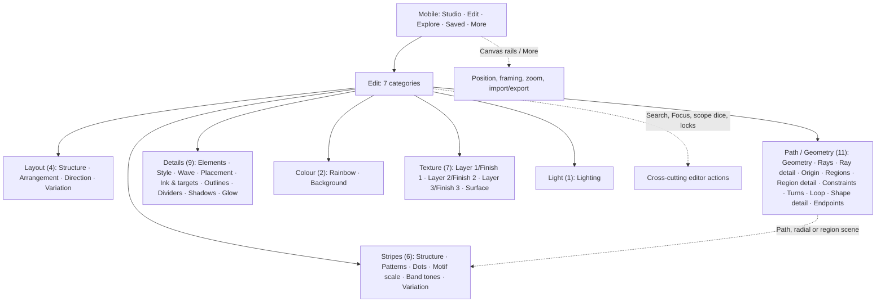
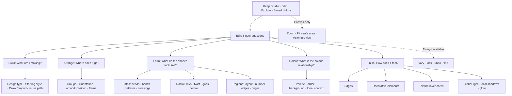
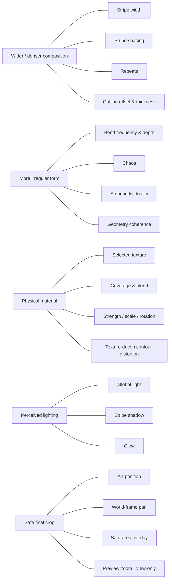

# ROYGBIV: Human-centred navigation and interaction map

## Live-main delta and authority boundary (2026-10-22)

**Current `main` checkpoint:** 7 Edit categories, **40 named tool cards, 95 canonical schema setting keys**; separate dynamic interior-element objects, Shape & Path Library, five mobile destinations. This supersedes the historical 40/87 and intermediate 43/95 maps for **live navigation**. Old snapshots remain historical research records, not today's menu specification. The original recipe/PNG/Saved identifiers were not migrated for these navigation fixes.

**Shipped and tested:** [#452](https://github.com/gamesbyian/wallgen/pull/452) truthful overlap/tonal choice; [#454](https://github.com/gamesbyian/wallgen/pull/454) contour prerequisites / Variation naming; [#455](https://github.com/gamesbyian/wallgen/pull/455) exact-field search and selected artistic-intent terms; [#459](https://github.com/gamesbyian/wallgen/pull/459) unified Texture Layer 1–3 with Material/Finish views (**43→40 tool cards**); [#460](https://github.com/gamesbyian/wallgen/pull/460) same selected interior element switchable in Style/Wave/Placement/Ink & Targets; [#461](https://github.com/gamesbyian/wallgen/pull/461) honest scattered size and imported-placeholder feedback; [#462](https://github.com/gamesbyian/wallgen/pull/462) direct Light/Shadow/Glow links; [#463](https://github.com/gamesbyian/wallgen/pull/463) dormant Dots/Motif Scale activation routes; [#465](https://github.com/gamesbyian/wallgen/pull/465) deliberate Design Type → relevant Geometry next step. All applicable existing PR Node CI passed; **a new physical-phone usability or multi-breakpoint visual acceptance was not run for these changes**.

**Outstanding, not silently closed:** C07 search multiple-match disambiguation and keyboard flow; C09 optional reduction of the five interior-element *tool* destinations into a cohesive selected-object inspector (persistent selection is already shipped); C10 evaluate whether direct lighting links suffice before making a giant mixed-effects card; C11 optional intent-first Arrange/Form prototype; C03 decision on temporary silhouette placeholder versus alternative empty state; targeted Pixel portrait fit, screen-reader/touch/restore checks for the recent controls; review other live semantic findings C14–C17 before marking them inapplicable. Remain within a small evidence budget and avoid compulsory CI screenshot matrices. Main [roadmap](docs/ACTIVE-PRODUCT-ROADMAP-2026-10-22.md) and [UX queue](docs/UI-REDESIGN-IMPLEMENTATION-QUEUE.md) are the operational tracking authorities; [#444](https://github.com/gamesbyian/wallgen/issues/444) remains the umbrella.

For dates and historical examples, read all subsequent sections below as **snapshots at their stated commits**. In particular, mentions of six distinct Layer/Finish tools or 43 named tools describe *the pre-#459 application*, and should not be used for new changes. Exact current setting homes must be retrieved from `src/editor-schema.js` and `src/editor-layout.js`. Causality and research insights still apply; the five-workspace concept has not been implemented. See the [live completion queue](UI-REDESIGN-IMPLEMENTATION-QUEUE.md) before work.

---

**Status:** design analysis and proposed IA only, not an implemented UI. **Date:** 2026-10-22. **Scope:** present main-branch control architecture, plus clearly labelled future integrations. **Source:** [editor schema](../src/editor-schema.js), [live editor assembly](../src/editor-layout.js), [scene applicability](../src/editor-tool-applicability.js), [mobile destinations](../src/mobile-five-nav.js), [mobile More](../src/mobile-studio.js), [actual static controls](../index.html), [interior elements UI](../src/app.js), [terminology audit](UI-TERMINOLOGY-AUDIT-2026-10-21.md), and [mobile destination notes](MOBILE-FIVE-DESTINATION-TRIAL.md).

## Research foundation and first comparative check

**Agent learning guide:** [Human expectations, creativity and procedural composition](AGENT-HUMAN-EXPECTATIONS-AND-CREATIVE-COMPOSITION.md) synthesizes cognitive walkthroughs, task analysis, card sorting, tree testing, information scent, QOC design rationale, creativity-support metrics, art composition, shape grammars, instructional generative art, and constraints against invented human results.

**Applied evaluation:** [IA research assessment](IA-RESEARCH-APPLIED-ASSESSMENT-2026-10-22.md) compares the existing seven categories, five intention-led workspaces and a hybrid approach, with four example cognitive walkthroughs and an explicitly qualified **16-task route-travel proxy**. [Read the deterministic comparison tool](../scripts/ia-structure-evaluate.mjs), which validates all 87 schema setting keys and makes no claims about observed human success or time saved.

**Current disposition:** The five-workspace model has promising structural locality for selected tasks, but a hairpin task is *worse*, and no human tree test has been performed. Prefer cheap self-contained texture/element editor prototypes and contextual cross-links before a wholesale navigation rewrite. This is comparative research, not authorisation to ship the proposed tree.

## 0. Read this as a design research instrument

This document deliberately contains TWO distinct taxonomies, not a magical replacement of one menu with another.

- **Physical home:** each persistent recipe setting retains one canonical technical owner and one ordinary edit home; no duplicate mutable inputs.
- **Conceptual relationships:** a setting can be surfaced by multiple user intents through navigation, preview-driven deep links and contextual *related* affordances, without cloning it or silently altering the saved recipe.

Human prompts used throughout: What can I see change? How dramatically? How commonly would I adjust this? What prerequisites make it active? What other adjustments will I probably want beside it? Am I changing the wallpaper or merely how I inspect it? These are *hypotheses about usage*, not telemetry and not user-research results.

**Impact legend:** 4 = can remake the picture/composition; 3 = major stylistic/readability change; 2 = noticeable finishing change; 1 = fine detail; 0 = preview/navigation only. Impact depends on active mode, artwork and current value: a control may have literally zero effect in an inapplicable state.

**Frequency legend:** F = frequent in a typical exploratory design session; O = occasionally used once a direction is found; S = specialist/infrequent. These are *estimated design priorities*, not measured behavior. One user can have substantially different frequencies.

**State legend:** applicable, dormant (retains value but cannot change current picture), active with no visible contribution (e.g. zero strength), view-only, irreversible/destructive, and global action. Dormancy should explain itself and never silently reset recipe data or locks.

## Visual overview: compare the two trees

The diagrams intentionally show hierarchy, not the complete 87-key setting table. The full setting-level relationship map follows below.

### Current main-branch editor

### Proposed intention-led editor

### A causal relationship map, not a new menu

**Interpretation:** A tree tells someone *where* to go. These causal clusters tell the interface *what else to bring within reach* after the person acts.

## 1. Existing UI: routes and mechanics

### 1.1 First level: mobile destinations

- **Studio** → uncluttered live wallpaper. User asks “What did I make?” Has Favourite, Download, canvas-level actions, safe-area guide, artwork nudges, view zoom/Fit.
- **Edit** → one panel of seven categories; each category has a horizontal row of named tools and a single tool card. User asks “What can I change?” Supports per-setting, tool and category variation, lock protection, Focus mode, search and undo.
- **Explore** → cached/generated twelve-image contact sheet, switch variation into canvas. User asks “What else could this become?”
- **Saved** → locally stored favourite wallpapers (separate from the Explore contact sheet). User asks “Where is that good one?” This is not currently a geometry-asset library.
- **More** → mixed utility drawer. “Generate” houses Shuffle/Generate 12 plus desktop action tray; “Files & sharing” houses PNG/recipe import, export metadata, share/JSON; “Position & info” houses art-position nudges, view-frame pan, summary data. The same live DOM controls are moved, rather than copied.
- **Desktop** has a visible sidebar/editor, workspace preview, action tray, gallery and related utilities; the same underlying editor/control identities apply.

Desktop/mobile details and Gallery surface visibility change, but these destinations describe different **user jobs**: see, change, diverge, recover, transfer. Retain the five; they are a strong boundary.

### 1.2 Editor: current topology

The schema provides 7 categories, 40 named tools, 87 distinct setting keys. The old static HTML 4-panel form is remounted into this schema; source controls and serialization identities persist.

Layout (4 tools, 9 keys) → Structure · Arrangement · Direction · Variation

Path (11 tools, 27 keys) → Geometry · Radial rays · Ray detail · Origin · Regions · Region detail · Constraints · Turns · Loop · Shape detail · Endpoints

Stripes (6 tools, 13 keys) → Structure · Patterns · Dots · Motif scale · Band tones · Variation

Details (9 tools, 9 keys) → Elements · Style · Wave · Placement · Ink & targets · Outlines · Dividers · Shadows · Glow

Colour (2 tools, 3 keys) → Rainbow · Background

Texture (7 tools, 22 keys) → Layer 1 · Finish 1 · Layer 2 · Finish 2 · Layer 3 · Finish 3 · Surface

Light (1 tools, 4 keys) → Lighting

### 1.3 Controls that are NOT in the 87-key editor schema

These are easy to omit when treating the schema as the entire experience:

| Action / property | User intent | Rendered impact | Natural adjacency |
|---|---|---|---|
| Starting style (family) | Get an initial art direction or a style-level preset | 4 | Design type, Palette, Geometry, Pattern |
| Randomize all (Random / Shuffle) | Start a substantially new direction; preserve locks as specified | 4 | Starting style, locks, history, seed |
| Primes only | Constrain randomized percentage/rotation number choices | indirect / experimental | Randomization options, not Structure |
| Reroll versus Vary; Gentle / Moderate / Wild | Choose large redraw vs similar neighbor and range of deviation | up to 4 | Explore, scoped per-setting/tool/category action |
| Reroll category/tool/setting (“dice”) | Search locally rather than remake whole design | varies by target | Directly adjacent to targeted parameter |
| Protect setting (locks, including auto-resolved states) | Preserve an element of a good design during exploration | indirect / high workflow value | Variation and undo |
| Seed input / Apply seed / New variation | Reproduce a result or vary random content without changing settings | up to 4 | Create/Explore/History, reproducible metadata |
| Undo; exploration history | Return from a failed direction | 4 for restoration | Every edit and variation surface |
| Draw path, Use path / Redraw / Cancel | Supply bespoke path geometry | 4 | Paths design type, Form, path library |
| Draw smoothing; smooth/geometric; edit/add/delete/corner/re-smooth point; point undo; extend ends | Refine hand-authored geometry before committing | 4 to 2 | Paths > geometry; endpoint controls; viewport |
| Import image; choose candidate; rotate/reselect; edit extracted path | Convert imported pixels/SVG to source path | 4 | Custom geometry, shape/path library |
| Artwork position X/Y nudges / reset | Move actual composition within wallpaper | 4 | Arrangement, crop, negative space |
| View-frame pan X/Y / reset | Select a different view window into the composition; source documents call it a world-coordinate framing action | 4 *if output framing changes* | Artwork position, crop; verify recipe/export semantics |
| Zoom in / out / Fit | Adjust how preview is displayed; do not mutate generator settings | 0 | Canvas tools and inspection |
| Safe area guide | Check placement of focal content for phone use | 0 | Preview, positioning, export |
| Theme | Switch UI cream/dark presentation | 0 | App preference, not wallpaper background |
| Favourite / Save locally; Saved gallery | Keep/reload an artwork recipe | 0 to restored 4 | Studio, Explore, history |
| PNG Download; recipe copy/download; copy link; import PNG/JSON design | Move reproducible wallpaper outside/into app | 0 to restored 4 | Saved, Files & sharing |
| PNG metadata fields | Attach title, creator, description, copyright, keywords, date, camera/software notes | 0 (image pixels unchanged) | Export |
| Focus / All controls; find setting | Navigate/adjust one parameter without other controls competing | 0 | Editor search / navigation |
| Variation gallery “Generate 12” | Compare alternatives before choosing one | 4 for selected result | Explore, starting style, scope |

**Caution:** “View-frame pan” is named differently from non-exporting *preview zoom* in source. Do not lump them together as display-only without tests. Inspect camera/recipe/export contracts before moving their UI.

### 1.4 Applicability and dependencies (from scene routing, not guessed)

- **Paths:** path Geometry, Constraints, Turns, Loop, Shape detail and Endpoints; all six Stripes tools (Tonal controls further depend on tonal construction); Draw / Import path available.
- **Radial:** Radial rays, Ray detail, Origin. The Stripes category is unavailable, but textures, lighting, interior detail and dividers can apply.
- **Regions:** Regions and Region detail, plus Origin only for nested layout. Stripes category unavailable; dividers and interior elements apply.
- **Layout exception:** outside Paths, only Design type remains in Layout, so orientation/arrangement/chaos do *not* constitute universal layout controls today. This sharply limits how much of the proposed “Arrange” workspace can be universal without engine work.
- **Outline vs divider:** stripe outlines only for Paths; region/ray dividers only outside Paths. The user intent is the same “separate edges” and these should share a visible *intent*, while the underlying controls remain mode-specific.
- **Surface contour distortion:** restricted to Paths, and the recent material implementation makes it depend on texture applied to stripes. Distortion is not a free-standing noise slider.
- **Optional material layers:** second and third enabled states are internal flags; present as contextual optional layer cards rather than independent prominent creative options.
- **Dynamic interior elements:** up to eight objects, separate from the 87 keys, with manager, appearance, oscillation, placement and colour/object filters. Treat their five current *navigation* tools as one object-editing workflow.

## 2. Exhaustive present-day parameter and tool atlas

Each named tool is mapped to its human purpose and closest neighbors. Each setting gets an individually stated effect, visual influence, estimated use cadence, and connections. “Freq” values are assumptions to validate, not claims about recorded usage.

### Layout

| Named tool (stable ID) | Human question / outcome | Impact | Frequency | Closest relationship |
|---|---|:---:|:---:|---|
| **Structure** (`layout/structure-mode`) | Choose the artwork's fundamental kind | 4 | O | Starting style; mode-specific Form |
| **Arrangement** (`layout/arrange`) | Decide how many rainbow groups and how they occupy space | 4 | F | Orientation; Frame; stripe dimensions |
| **Direction** (`layout/direction`) | Turn/flip the global picture | 4 | F | Arrangement; origin; crop |
| **Variation** (`layout/variability`) | Vary overall generated composition disorder | 3 | F | Path bends; stripe individuality; randomizer |

| Individual setting (stable key) | What it changes / when useful | Impact | Frequency | Interacts with |
|---|---|:---:|:---:|---|
| `structure` (Structure) | Switches among independent path/ribbon, radial, and closed-region renderers; changes the whole picture grammar | 4 | O | All contextual tools; existing geometry may be dormant when switched |
| `composition` (Arrangement) | Sets one rainbow, repeated groups, or separately floating path strips | 4 | F | repeatCount, repeatSpacing, pathLength, stripeWidth |
| `repeatCount` (Arrangement) | Counts repeated rainbow groups, conditional on repeat composition | 3 | O | composition, repeatSpacing, stripeWidth |
| `repeatSpacing` (Arrangement) | Changes separation between repeated rainbow groups | 3 | F | composition, repeatCount, spread, wallpaper frame |
| `orientation` (Direction) | Chooses vertical, horizontal, diagonal, or automatic paths | 4 | F | diagonalRotation, mirrorHorizontal, mirrorVertical, canvas framing |
| `diagonalRotation` (Direction) | Turns diagonal paths relative to their seed-selected angle | 3 | O | orientation=diagonal, mirror toggles, composition and frame |
| `mirrorHorizontal` (Direction) | Flips diagonal geometry horizontally | 3 | O | orientation=diagonal, diagonalRotation, off-frame crop |
| `mirrorVertical` (Direction) | Flips diagonal geometry vertically | 3 | O | orientation=diagonal, diagonalRotation, off-frame crop |
| `chaos` (Variation) | Changes irregularity of generated geometric composition; not the randomization action | 3 | F | geometry, shapeFrequency, shapeDepth, individuality |

### Path

| Named tool (stable ID) | Human question / outcome | Impact | Frequency | Closest relationship |
|---|---|:---:|:---:|---|
| **Geometry** (`path/geometry`) | Choose path curvature grammar and bend rhythm | 4 | F | Turns; Loops; Constraints |
| **Radial rays** (`path/rays`) | Choose radial construction and count/rotation | 4 | O | Ray detail; Origin; negative space |
| **Ray detail** (`path/ray-shape`) | Set fan twist, coverage and central opening | 4 | F | Radial rays; canvas background |
| **Origin** (`path/origin`) | Move centre of radial or nested forms | 4 | O | Frame/nudges; radial/regions selection |
| **Regions** (`path/regions`) | Choose closed-region layout and density | 4 | O | Region detail; dividers; interior elements |
| **Region detail** (`path/region-detail`) | Tune boundary irregularity and nested polygonality | 3 | O | Region layout; dividers |
| **Constraints** (`path/safety`) | Control path coherence and intersections | 3 | S | Bends; crossings; stripe shadows |
| **Turns** (`path/turn`) | Tune hairpin shapes | 3 | S | Chosen path geometry |
| **Loop** (`path/single-loop`) | Tune single-loop shape | 3 | S | Chosen loop geometry |
| **Shape detail** (`path/shape-details`) | Tune special geometry-specific parameters | 3 | S | Geometry choice; width |
| **Endpoints** (`path/ends`) | Modify length/termination/bleed of open ribbons | 4 | O | Floating arrangement; draw/import paths |

| Individual setting (stable key) | What it changes / when useful | Impact | Frequency | Interacts with |
|---|---|:---:|:---:|---|
| `geometry` (Geometry) | Chooses the path's governing shape family, including special turn and loop forms | 4 | F | shapeFrequency/depth, turn, loop, safety |
| `shapeFrequency` (Geometry) | Controls number/tightness of path bends where geometry supports them | 3 | F | geometry, shapeDepth, chaos |
| `shapeDepth` (Geometry) | Controls amplitude/severity of path bends | 3 | F | geometry, shapeFrequency, geometrySafety |
| `radialMode` (Radial rays) | Switches among wedges, starburst, pinwheel, spokes, concentric bands | 4 | O | rayCount, rayTwist, rayCore, origin |
| `rayCount` (Radial rays) | Controls radial subdivisions/repetitions | 4 | F | radialMode, rayCoverage, dividerWidth |
| `rayRotation` (Radial rays) | Rotates ray field | 3 | F | radialMode, rayTwist, origin |
| `rayTwist` (Ray detail) | Turns rays toward spiral/pinwheel shapes | 3 | F | radialMode, rayRotation, origin |
| `rayCoverage` (Ray detail) | Changes radial ray width and background exposure | 4 | F | rayCount, rayCore, background |
| `rayCore` (Ray detail) | Opens or closes central negative space in rays | 3 | O | rayCoverage, origin, background |
| `fieldCenterX` (Origin) | Shifts the origin of radial fields or nested regions horizontally | 4 | O | fieldCenterY, ray family, nested-region shape, framing |
| `fieldCenterY` (Origin) | Shifts the origin vertically | 4 | O | fieldCenterX, ray family, nested-region shape, framing |
| `regionMode` (Regions) | Chooses Voronoi/organic/facets/blocks/nested region topology | 4 | O | regionCount, regionJitter, regionSides, dividers |
| `regionCount` (Regions) | Changes the count/density of generated regions (legacy multiples of seven) | 4 | F | regionMode, dividerWidth, element placement |
| `regionJitter` (Region detail) | Makes region boundaries/arrangements less regular where relevant | 3 | F | regionMode, regionCount, dividers |
| `regionSides` (Region detail) | Changes nested shape circularity/polygon side count (0 circle) | 3 | O | regionMode=nested, origin, dividers |
| `geometrySafety` (Constraints) | Protects stripe order/coherence from extreme bends and folds | 3 | O | geometry, shapeDepth, crossings |
| `crossingMode` (Constraints) | Controls which stripe passes above or below, or alternates at intersections | 3 | O | geometry, geometrySafety, shadows |
| `turnRadius` (Turns) | Bend radius of hairpin geometry | 3 | O | geometry=hairpin, hairpinAngle, width |
| `hairpinAngle` (Turns) | Degrees of a hairpin reversal | 3 | O | geometry=hairpin, turnRadius |
| `loopRadius` (Loop) | Loop size | 3 | O | geometry=loop, loopSweep, width |
| `loopSweep` (Loop) | Amount of turn in a single-loop form | 3 | O | geometry=loop, loopRadius |
| `stepCount` (Shape detail) | Number of stepped segments in applicable path geometry | 3 | O | geometry=stepped, shapeDepth, stripe width |
| `chevronSharpness` (Shape detail) | Pointiness of chevron geometry where relevant | 3 | O | geometry=chevron, shapeDepth |
| `loopAspect` (Shape detail) | Aspect ratio of loop geometry | 3 | O | geometry=loop, loopRadius |
| `pathLength` (Endpoints) | Length of independent floating ribbons | 4 | O | composition=floating, endTaper, frame |
| `endTaper` (Endpoints) | Narrows ribbon ends instead of blunt termination | 2 | O | composition=floating or visible endpoints, stripeWidth |
| `extendDrawnPath` (Endpoints) | Continues open drawn/imported paths beyond wallpaper frame | 3 | O | drawn/imported paths, crop, framing |

### Stripes

| Named tool (stable ID) | Human question / outcome | Impact | Frequency | Closest relationship |
|---|---|:---:|:---:|---|
| **Structure** (`stripes/structure`) | Specify width, gaps and stripe construction | 4 | F | Motifs; outline; overall layout |
| **Patterns** (`stripes/patterns`) | Select repeated motif, line type, uniformity | 4 | F | Motif scale; Dots; character |
| **Dots** (`stripes/marks`) | Tune dots | 3 | S | Motif; scale; stripe width |
| **Motif scale** (`stripes/motif-scale`) | Tune pattern size and repetition | 3 | O | Pattern type; marks |
| **Band tones** (`stripes/tone`) | Adjust tonal stripe construction | 3 | S | Stripe type; palette/background |
| **Variation** (`stripes/character`) | Distinguish individual stripes and optionally their patterns | 3 | F | Chaos; motif uniformity |

| Individual setting (stable key) | What it changes / when useful | Impact | Frequency | Interacts with |
|---|---|:---:|:---:|---|
| `construction` (Structure) | Switches stripe construction among patterned ribbon, line, tonal, woven | 4 | F | stripeWidth, motif, tonalContrast, crossingMode |
| `stripeWidth` (Structure) | Controls dominant stripe thickness and visual weight | 4 | F | spread, outline thickness, construction, composition |
| `spread` (Structure) | Controls gaps and stripe separation, independent of thickness | 4 | F | stripeWidth, outlines, background |
| `motif` (Patterns) | Chooses pattern within ribbon: solid, dots, stars, dashes, diamonds, chevrons, hatch, checker | 4 | F | motifSize, motifFrequency, dotSize/Spacing, patternHomogeneity |
| `lineStyle` (Patterns) | Chooses continuous/dotted/dashed line appearance | 3 | O | construction=stroke, stripeWidth |
| `patternHomogeneity` (Patterns) | How consistently patterns repeat across individual stripes | 3 | O | motif, individuality, overridePatternHomogeneity |
| `dotSize` (Dots) | Diameter of dot marks | 2 | O | motif=dots, dotSpacing, stripeWidth |
| `dotSpacing` (Dots) | Spacing between dot marks | 3 | O | motif=dots, dotSize, motifFrequency |
| `motifSize` (Motif scale) | Scale of repeated stripe motifs | 3 | F | motif, motifFrequency, patternHomogeneity |
| `motifFrequency` (Motif scale) | Density/frequency of repeated stripe motifs | 3 | F | motif, motifSize, dotSpacing |
| `tonalContrast` (Band tones) | Difference between tonal bands in tonal stripe construction | 3 | O | construction=tonal, palette, background |
| `individuality` (Variation) | Independent geometry variation among stripes, not a new motif selector | 3 | F | chaos, stripeWidth, geometry, overridePatternHomogeneity |
| `overridePatternHomogeneity` (Variation) | Allows stripe individuality to diversify pattern attributes too | 3 | O | individuality, patternHomogeneity, motif |

### Details

| Named tool (stable ID) | Human question / outcome | Impact | Frequency | Closest relationship |
|---|---|:---:|:---:|---|
| **Elements** (`details/interior`) | Create, select, order, enable/lock decorative elements | 4 | O | Style, Wave, Placement, Ink & targets |
| **Style** (`details/interior-style`) | Style currently selected interior element | 3 | O | Elements; Wave; Placement |
| **Wave** (`details/interior-motion`) | Adjust static oscillating decoration, not animation | 3 | S | Interior element shape; placement |
| **Placement** (`details/interior-placement`) | Choose local/field/contour coordinates and stroke size | 4 | O | Interior element type; regions/rays |
| **Ink & targets** (`details/interior-targets`) | Choose the ink colour and target rainbow slots/shapes | 3 | O | Interior element; palette; selected objects |
| **Outlines** (`details/outlines`) | Draw stripe edge decoration | 3 | F | Stripe width and spacing; background |
| **Dividers** (`details/dividers`) | Separate radial rays and region polygons | 3 | F | Region/ray count; background |
| **Shadows** (`details/shadows`) | Add local shadow under stripes | 3 | O | Global lighting; crossing order; glow |
| **Glow** (`details/glow`) | Make stripe edges luminous | 3 | O | Palette/background; local shadows |

| Individual setting (stable key) | What it changes / when useful | Impact | Frequency | Interacts with |
|---|---|:---:|:---:|---|
| `outline` (Outlines) | Selects stripe edge-line style, including coloured/black/white/double variants | 3 | F | gap, outlineBuffer, stripeWidth, background |
| `gap` (Outlines) | Changes outline stroke thickness (despite underlying key name) | 3 | F | outline, outlineBuffer, stripeWidth |
| `outlineBuffer` (Outlines) | Changes offset between stripe edge and outline | 2 | O | outline, gap, spread |
| `dividerColor` (Dividers) | Chooses separator colour for non-path closed regions or rays | 3 | O | dividerWidth, regionCount, background |
| `dividerWidth` (Dividers) | Sets divider thickness between non-path shapes | 3 | F | dividerColor, regionCount, rayCount |
| `stripeShadowStrength` (Shadows) | Depth/strength of shadow cast by stripe objects | 3 | O | stripeShadowSoftness, stripeShadowDirection, background |
| `stripeShadowSoftness` (Shadows) | Hardness or softness of local stripe shadows | 2 | O | stripeShadowStrength, stripeShadowDirection |
| `stripeShadowDirection` (Shadows) | Direction of local stripe shadow lighting | 2 | O | stripeShadowStrength, global lightDirection |
| `glow` (Glow) | Adds neon edge light around stripes | 3 | O | palette, background, stripeWidth, lighting |

### Colour

| Named tool (stable ID) | Human question / outcome | Impact | Frequency | Closest relationship |
|---|---|:---:|:---:|---|
| **Rainbow** (`colour/rainbow`) | Choose colour family and reverse order | 4 | F | Background, stripe arrangement |
| **Background** (`colour/canvas`) | Choose negative-space field colour | 4 | F | Palette, outlines, spacing, light |

| Individual setting (stable key) | What it changes / when useful | Impact | Frequency | Interacts with |
|---|---|:---:|:---:|---|
| `palette` (Rainbow) | Chooses the seven-hue family / colour story | 4 | F | background, reverseStripes, tonalContrast, texture/blend |
| `reverseStripes` (Rainbow) | Reverses stripe/order assignment so violet begins first | 4 | O | palette, orientation, repeatCount |
| `background` (Background) | Switches the canvas field between black and white | 4 | F | rayCoverage, spread, outline, contrast, lighting |

### Texture

| Named tool (stable ID) | Human question / outcome | Impact | Frequency | Closest relationship |
|---|---|:---:|:---:|---|
| **Layer 1** (`material/layer1`) | Choose material/target/blend of first surface texture | 3 | F | Finish1; colours; contour distortion |
| **Finish 1** (`material/finish1`) | Tune strength/scale/rotation of texture 1 | 3 | F | Layer1; layer2 blending |
| **Layer 2** (`material/layer2`) | Choose optional additional material layer | 3 | O | Finish2; layer1; layer3 |
| **Finish 2** (`material/finish2`) | Tune second texture | 3 | O | Layer2; layer1 |
| **Layer 3** (`material/layer3`) | Choose third material | 3 | S | Finish3; other layers |
| **Finish 3** (`material/finish3`) | Tune third texture | 3 | S | Layer3; other layers |
| **Surface** (`material/surface`) | Distort stripe contours via texture and roughen pigment | 3 | O | Texture applies to stripes; stripe edge geometry |

| Individual setting (stable key) | What it changes / when useful | Impact | Frequency | Interacts with |
|---|---|:---:|:---:|---|
| `material` (Layer 1) | Chooses first textural material or smooth surface | 3 | F | textureCoverage, textureStrength, textureBlend |
| `textureCoverage` (Layer 1) | Targets first texture to background, stripes/shapes, or both | 3 | F | material, textureDisplacement, background |
| `textureBlend` (Layer 1) | Blend/composite behavior for first material | 3 | O | material, textureStrength, palette/background |
| `textureLayer2Enabled` (Layer 1) | Internal visibility/activation gate for second texture layer; no standalone user-labelled toggle | 2 | S | material2, layer 2 panel; currently hidden input |
| `textureStrength` (Finish 1) | First texture opacity/intensity | 3 | F | material, textureBlend, textureCoverage |
| `textureScale` (Finish 1) | First texture spatial grain/mark scale | 3 | O | material, textureStrength |
| `textureRotation` (Finish 1) | Turns first texture's directional grain | 2 | O | material, textureScale, motif direction |
| `material2` (Layer 2) | Picks optional second textural material | 3 | O | textureLayer2Enabled, textureCoverage2, textureBlend2 |
| `textureCoverage2` (Layer 2) | Targets second texture to background or ink | 3 | O | material2, textureDisplacement |
| `textureBlend2` (Layer 2) | Blending of second material with image and first layer | 3 | O | material2, textureStrength2, first texture |
| `textureLayer3Enabled` (Layer 2) | Internal visibility/activation gate for third texture layer; no standalone user-labelled toggle | 2 | S | material3, layer 3 panel; currently hidden input |
| `textureStrength2` (Finish 2) | Second texture strength | 3 | O | material2, textureBlend2 |
| `textureScale2` (Finish 2) | Second texture mark size | 2 | O | material2, textureStrength2 |
| `textureRotation2` (Finish 2) | Second texture direction | 2 | S | material2, textureScale2 |
| `material3` (Layer 3) | Picks optional third material | 3 | S | textureLayer3Enabled, other texture layers |
| `textureCoverage3` (Layer 3) | Targets third texture to canvas or artwork | 3 | S | material3, textureDisplacement |
| `textureBlend3` (Layer 3) | Compositing of third layer | 3 | S | material3, preceding textures |
| `textureStrength3` (Finish 3) | Third texture strength | 3 | S | material3, textureBlend3 |
| `textureScale3` (Finish 3) | Third texture spatial scale | 2 | S | material3, textureStrength3 |
| `textureRotation3` (Finish 3) | Third texture direction | 2 | S | material3, textureScale3 |
| `textureDisplacement` (Surface) | Distorts stripe contours using actual stripe-applied active texture | 3 | O | material, textureCoverage, textureStrength; inactive with no suitable applied texture |
| `brushRoughness` (Surface) | Adds/changes rough pigment edge treatment | 2 | O | stripe contours, texture material, stripeWidth |

### Light

| Named tool (stable ID) | Human question / outcome | Impact | Frequency | Closest relationship |
|---|---|:---:|:---:|---|
| **Lighting** (`effects/lighting`) | Choose global ambient light and shading | 3 | O | Stripe shadow; glow; background |

| Individual setting (stable key) | What it changes / when useful | Impact | Frequency | Interacts with |
|---|---|:---:|:---:|---|
| `lightingMood` (Lighting) | Enables/chooses global ambience such as daylight, gold, moonlight | 3 | O | lightDirection, lightStrength, shadowStrength |
| `lightDirection` (Lighting) | Direction of global canvas illumination | 3 | O | lightingMood, lightStrength, stripe shadows |
| `lightStrength` (Lighting) | Intensity of overall illumination | 3 | O | lightingMood, lightDirection |
| `shadowStrength` (Lighting) | Amount of global canvas shading/vignette, distinct from stripe shadows | 3 | O | lightingMood, lightStrength |

## 3. Dynamic element controls: the additional conceptual map

The five zero-static-key interior tools are a small object editor embedded in the normal parameter editor. They need their own map, otherwise “every setting” is misleading:

| Current tool | User's goal | Component controls | Key dependencies / impact |
|---|---|---|---|
| Elements | “Add a line/band decoration inside my shapes” | choose element, add/remove (max 8), reorder up/down, enable, lock entire stack | Large when bands/lines dominate, otherwise medium; unlock before editing; selection drives all following cards |
| Style | “What does this mark look like?” | line/band Type; Shape (straight/wave/zigzag/loop); Stroke (solid/dashed/dotted) | Changes valid width semantics and which oscillation sliders matter |
| Wave | “How is this repeating, curving decoration bent?” | Amplitude, Frequency/Cycles, Phase | Static rendered wave/zigzag/loop; not animation. Straight nonoscillating shapes disable amplitude/phase |
| Placement | “Where does it live?” | local / field / contour placement, Position, band% or line width, Opacity | Can change coverage dramatically, especially when a field spans several coloured objects |
| Ink & targets | “Which colours/shapes receive it, in which ink?” | white/black/lighter/darker/custom ink, custom colour, seven ROYGBIV slot targets, clear inherited object-id scope | Hidden/filtered work can look broken if target object IDs are stale after scene switch |

Selected element, style, placement and colour targeting should appear as one persistent **element inspector** rather than five equal-weight sibling tools. There should be a visible Add → Shape & Ink → Position & Rhythm → Targets flow. Element selection and enable state must remain visible while editing the element.

## 4. Relationship map: edges between settings that belong to one creative thought

These edges are the central finding. A conventional folder tree hides them, so link them as contextual navigation.

1. **Fundamental picture kind:** Design type ↔ Starting style ↔ geometry family ↔ available authoring method. Design type is a structural fork, not a minor “Layout” property. Changing type can make existing values and authored paths dormant; preserve them.
2. **Width, density, negative space:** Stripe thickness ↔ stripe spacing ↔ repeat spacing/count ↔ outline thickness/offset ↔ background. More stripes and larger outlines can leave dramatically less visible canvas.
3. **Direction and composition:** Orientation ↔ diagonal angle/mirrors ↔ artwork position ↔ viewport framing ↔ safe-area preview. Put physical artwork movement next to the resulting crop; separately label zoom/Fit.
4. **Bend and turbulence:** Path geometry ↔ bend frequency ↔ bend depth ↔ chaos ↔ stripe individuality ↔ preserve coherence. Their interactions are more meaningful than their current category boundaries.
5. **Pattern as ornament:** Stripe construction ↔ motif ↔ motif scale/density ↔ dots/line style ↔ pattern uniformity ↔ pattern-variation override. Make irrelevant sliders dormant *inside* the visible pattern cluster rather than navigable empty destinations.
6. **Special shape parameters:** Hairpin radius+angle; Loop radius+sweep+aspect; Stepped count; Chevron sharpness. Children of selected geometry, not peer tabs competing with Geometry.
7. **Radial topology:** Radial design ↔ count ↔ twist/rotation ↔ ray coverage ↔ central gap ↔ origin. Splitting “Radial rays”, “Ray detail”, and “Origin” hides a single visual instrument.
8. **Regional topology:** Region layout ↔ count ↔ irregularity ↔ sides ↔ nested origin ↔ separator thickness. Density and dividers directly co-govern visual clutter.
9. **Colour contrast:** Palette ↔ background ↔ reversed colour order ↔ tonal contrast ↔ edge contrast ↔ texture blend. Surface finishes can change apparent colour even when palette keys remain unchanged.
10. **Edge treatment:** Path outlines ↔ outline width/offset; region/radial separators ↔ divider width/colour. One “Edges” destination selecting the relevant implementation.
11. **Atmosphere:** Global lighting ↔ canvas shading ↔ local stripe shadow ↔ glow. Distinguish global ambience from cast shadows, but place them in one Light subspace.
12. **Surface / printing character:** Texture material ↔ coverage ↔ blend ↔ strength/scale/rotation ↔ pigment roughness ↔ contour distortion. Distortion's prerequisites must appear adjacent to the layer producing it.
13. **Interior ornament:** element manager ↔ element type/shape ↔ wave parameters ↔ placement ↔ scope and ink. The currently navigable five tools should behave like tabs **within one selected element**, not five unrelated effects.
14. **Exploration transaction:** Seed ↔ Starting style ↔ randomization scope/magnitude ↔ locked parameters ↔ undo/history ↔ Saved. This is an always-accessible operation, not a “Variation” geometry control.

### Two kinds of relationships

**Prerequisite:** a control is meaningful only when another control is in a compatible state (e.g. diagonal rotation, loop radius, contour distortion, interior custom ink). Show it in place disabled with a terse reason, or expose it inline on selection. Do not lead to an empty page.

**Co-adjustment:** two controls are independently valid but often edited together (e.g. stripe width and spacing; region count and dividers). They deserve proximity, a nearby “Related” affordance, or a one-tap jump. Do not duplicate underlying form fields.

## 5. Proposed human-first IA: five editorial workspaces

Preserve the **five top-level mobile destinations** Studio / Edit / Explore / Saved / More. Within **Edit**, replace category-of-renderer thinking with five questions:

**1. Build** — *What am I making?*

- Design type: Paths & ribbons / Radial & bursts / Regions & partitions (later Scattered shapes).
- Starting style and style preset effects.
- For Paths: Draw path, Import image/path and Use saved path; expose editing of authored anchors in context.
- Future geometry assets: a searchable Shape & Path Library reachable here. It is distinct from wallpaper favourites.
- Do **not** bury design type behind parameter adjustment; it is one of the rare composition-changing branches.

**2. Arrange** — *Where is everything, and how does it fill the frame?*

- For Paths: Single / Repeated / Floating composition, repeat count and spacing.
- Orientation and diagonal-only angle/mirrors.
- Artwork Move (content position) and Frame (camera pan) appear side by side with unmistakably different names, descriptions and reset controls. Implementation must preserve pixel/recipe semantics.
- For radial/regions: origin inside Form when mode-specific; Arrange may offer a direct contextual link to it but not clone X/Y controls.
- Safe-area, zoom and Fit remain on canvas as *view* tools, not editable creative properties.
- Future independent scattered shapes should gain count/size/distribution/overlap/off-frame controls here as appropriate to their actual semantics.

**3. Form** — *What do the actual coloured shapes look like?*

- **Paths active:** Shape family → Bend (frequency, depth, chaos) → Special shape (conditional hairpin/loop/step/chevron) → Structure (construction, width, spacing) → Pattern (motif, scale/density/dots/line) → Individuality (stripe variation, pattern uniformity override) → Crossings/constraints → Endings (length, taper, extend).
- **Radial active:** Radial family → Rays (count/rotation/twist) → Size & gaps (coverage/core) → Origin.
- **Regions active:** Region family → Number & irregularity → Special nested details (sides, origin).
- Important: do not show 25 controls simultaneously. A horizontal tool rail or adaptive cards should collapse mode-incompatible groups, with live previews when selecting special geometry.
- “Stripe pattern” is separate from “texture material”: one defines geometric repeated ink marks, the other adds physical surface grain.

**4. Colour** — *Which colours, in which order, against what?*

- Palette (colour story), reverse rainbow order and background together.
- Tonal contrast only when tonal stripes are active, via a nearby contextual link or inline conditional control.
- Colour targets of **selected interior elements** remain in the element inspector, with a deep link from Colour, because these are object-local overrides and not a global eighth hue.
- Display-only Colour Vision Preview (pending PR #432) belongs by the canvas “Preview/Inspect” affordance, never as a persistent wallpaper recipe property.

**5. Finish** — *What makes the graphic feel drawn, printed or illuminated?*

- **Edges:** Path outline style/thickness/offset or radial/region divider colour/thickness, chosen by current structure.
- **Decorate:** Add/manage interior line or band → appearance → rhythm → placement → ink and targets; selection persists while switching subtabs.
- **Surface:** Three optional independent texture layer cards. Each self-contained card has material, coverage, blend, strength, scale, rotation and off/smooth state. Show layer 2/3 as inactive “No texture” until chosen. Pigment roughness nearby; texture-driven contour distortion appears only when a stripe-applied texture can drive it.
- **Light:** one compact panel containing global illumination/shading, local stripe shadows (Paths), and glow. Explain local vs global.
- Inactive/unsupported elements remain discoverable through help/search but must not masquerade as active adjustments.

This is a *proposed* grouping, not a claim it is proven better. Primary hypothesis: fewer arbitrary hand-offs between tabs will beat the current fixed subsystem categories, particularly on phones.

### Creative actions stay outside Edit's category tree

- **Global discovery:** Random new design vs New variation, Vary vs Reroll strength, scoped dice, Primes only, locks, undo, Explore 12. Keep the common next action close to the artwork, advanced controls progressively disclosed. Do not make the user navigate to “Form > Variation” to protect a favourite colour.
- **Inspect:** original canvas, Fit/Zoom, safe-area, view modes, future vision simulation. These do not get mixed into generated recipe parameters.
- **Save/export:** Favourite, PNG Download always within reach. Metadata, portable JSON, recipe import, share link, bulk backup in More / Files. Distinguish **Saved wallpapers** from **Saved geometry assets**.

## 6. Direct crosswalk: current → proposed

| Current category / tool | Proposed location | Why / disposition |
|---|---|---|
| Layout / Structure | Build / Design type | A structural fork determines what tools can possibly matter |
| Layout / Arrangement | Arrange / Repeat & distribute | Spatial composition, not a rendering subsystem |
| Layout / Direction | Arrange / Direction & transform | Kept adjacent to actual move/position |
| Layout / Variation | Form / Bend & variation (Paths) | Chaos affects drawn geometry, not the global explore command |
| Path / Geometry, Turns, Loop, Shape detail, Constraints, Endpoints | Form / Paths; contextual child cards | Shape-specific sliders revealed by the chosen shape |
| Path / Radial rays, Ray detail, Origin | Form / Radial | One coherent radial design instrument |
| Path / Regions, Region detail, nested Origin | Form / Regions | One coherent region-density / contour instrument |
| Stripes / Structure | Form / Bands & gaps | Width/spacing are basic shape proportions |
| Stripes / Patterns, Dots, Motif scale, Band tones | Form / Pattern; Colour / Tonal contrast context | Motif controls are one causal family, tonal effect is colour-driven |
| Stripes / Variation | Form / Stripe character | Individuality and pattern uniformity need neighboring controls |
| Details / Interior + four subtools | Finish / Decorate / selected element inspector | Stop treating the phases of editing one element as peer destinations |
| Details / Outlines + Dividers | Finish / Edges, mode-specific | Same human intent, mutually exclusive implementation |
| Details / Shadows + Glow; Light / Lighting | Finish / Light | Local and global illumination can be reasoned about together |
| Colour / Rainbow + Background | Colour | Strongest current pairing, keep |
| Texture / Layer 1–3 and Finish 1–3 | Finish / Surface / layer cards 1–3 | Material + its adjustments are one visual object |
| Texture / Surface | Finish / Surface / contour & pigment | Contextual material behavior, not generic Geometry |

## 7. Example intention-based routes

| Human goal | Present-day likely route | Proposed route |
|---|---|---|
| “Make this much more dramatic, diagonally” | Layout / Direction, then Path / Geometry and Layout / Variation | Arrange / Direction → Related: Form / Bends & chaos |
| “More space between the rainbow bands” | Stripes / Structure; perhaps Details / Outlines and Colour / Background | Form / Bands & gaps → Related: Finish / Edges; Colour / Background |
| “Make this look like old fabric” | Texture / Layer1, Finish1, maybe Layer2/Finish2, maybe Light | Finish / Surface / fabric layer with all adjustments → Related: Light |
| “Keep the exact colours, explore wilder shapes” | Colour / Rainbow locks, then category/tool scoped variation across Path / Layout | Lock palette directly → Form / Vary strength → Explore |
| “Make stained glass with thicker dividers” | Layout / Structure, Path / Regions, Path / Region detail, Details / Dividers | Build / Regions → Form / Cells → Finish / Edges |
| “The neon is good but its shadow is muddy” | Details / Glow, Details / Shadows, Light / Lighting | Finish / Light / Glow + local shadow + global illumination |
| “Add short dashed lines only inside blue areas” | Details / Elements → Style → Wave → Placement → Ink & targets | Finish / Decorate / Add line → Style / dash → Target Blue |
| “Put a hand-drawn loop on a different wallpaper” | Draw → Save as wallpaper, then loss-prone reuse unless asset branch installed | Build / Draw → Save path asset → new Build / Use asset (future PR #434) |
| “What would this look like with different colour vision?” | Pending More > Position & info (PR #432) | Canvas / Preview / Vision simulation (display-only) |
| “I like this; find nearby variants without losing it” | Favourite, lock controls, Vary/strength, Generate 12 | Favourite → scoped Vary → Explore variants → restore from Saved |

## 8. Design constraints and implementation-safe sequence

1. **First, collect concept data without changing any pixels:** retain canonical settings/IDs, add annotations (visible effect, scope, impact, prerequisites, related-to edges, suggested grouping). Turn the above manual atlas into a machine-readable mapping, checked against editor schema completeness. Keep the existing scene applicability contract.
2. **Prototype two navigation shells against identical source controls:** (A) existing seven-category editor + contextual related links; (B) Build/Arrange/Form/Colour/Finish with conditional tool cards. Do not instantiate duplicate inputs or separate “second editor” with divergent state.
3. **Pilot the strongest low-risk relocations:** local and global light together, self-contained texture layers, stripe width/spacing/outline relationship, selected interior element inspector. Preserve locks, undo, render and mobile accessibility.
4. **Add context-aware cross-links:** no duplicate setting owners. Selecting “Related: stripe spacing” navigates to the actual underlying field and focuses it. Search indexes both old and proposed terminology plus intent phrases (“more gaps”, “old paper”, “rotate”, “stained glass”).
5. **Keep modes truthful:** no radial-only tools pretending to work for paths, no region-specific controls outside regions, no texture contour distortion without relevant texture. Dormant fields do not get zeroed in recipes.
6. **Integrate pending work after merge:** Shape & Path Library PR #434 and Colour Vision Preview PR #432 are draft branches as of this review, not shipped features on main. Make their affordances conceptual placeholders until integration.
7. **Measure actual tasks rather than screenshot volume:** lightweight tree tests and first-click task probes: eight natural-language goals above, first expected destination, number of nonproductive tab jumps, ability to find related control, and preservation of a locked setting during Vary. Minimal smoke to confirm full recipe/PNG fidelity, Undo, search, keyboard/touch and scene switches.

### Hypotheses to test; do not mistake them for findings

- Most users will associate background with Colour and texture with Finish; these likely require no relocation.
- Texture layer/finish separation, splitting lighting across Details/Light, and fragmenting radial geometry are high-confidence *architectural friction candidates*.
- “Build” might be mistaken for global generation rather than composition. Test “Create”, “Design” or a persistent Design Type selector; do not settle by name preference alone.
- “Form” may become too full for Paths; test one contextual rail whose visible tabs depend on geometry, against a separate path-only Stripes tab. Do not force a universal five-tab ideal on every scene.
- Preserve the existing five mobile destinations unless tested tasks demonstrate real benefit to changing them.

### Useful external IA precedents

- Nielsen Norman Group, [Information Architecture Study Guide](https://www.nngroup.com/articles/ia-study-guide/): distinguish taxonomy from navigation, test with card sorting and tree tests, and cross-list ambiguous items.
- Nielsen Norman Group, [Mini-IA: Structuring the Information About a Concept](https://www.nngroup.com/articles/mini-ia-structuring-information/): organise subtopics by use rather than internal organisation.
- Figma, [layer properties in the right sidebar](https://help.figma.com/hc/en-us/articles/360039832014-Design-prototype-and-explore-layer-properties-in-the-right-sidebar): selected-object properties are contextual while page-level controls remain available.
- Figma, [UI design principles](https://www.figma.com/resource-library/ui-design-principles/): progressive disclosure with clear orientation as complexity increases.

**Decision request:** This is intended as a comparison baseline, not an instruction to rework live navigation immediately. Choose whether to prototype a conceptual reorganisation or first validate the most consequential cross-links with the existing seven categories. Both can use exactly the same canonical recipe model and renderer.
