# Actual implementation companion (source screenshots)

**All images are byte-exact screenshots of the actual app**, not approved-reference redraws. Independent AI optical inspection was conducted before promotion. The original twelve SVG wireframes remain unchanged. Source was [Chromium run 39527554784](https://github.com/gamesbyian/wallgen/actions/runs/39527554784), tested checkout sha 89b09ea54da1368335785038bfd05eeed717eb8f. No presentation files changed between source approval and this commit. See review-provenance.json for the 32 SHA-256 values.

## 12 source states in both themes at 412 x 892

| Source state | Cream | Dark | Original schematic |
| :--- | :---: | :---: | :--- |
| studio | 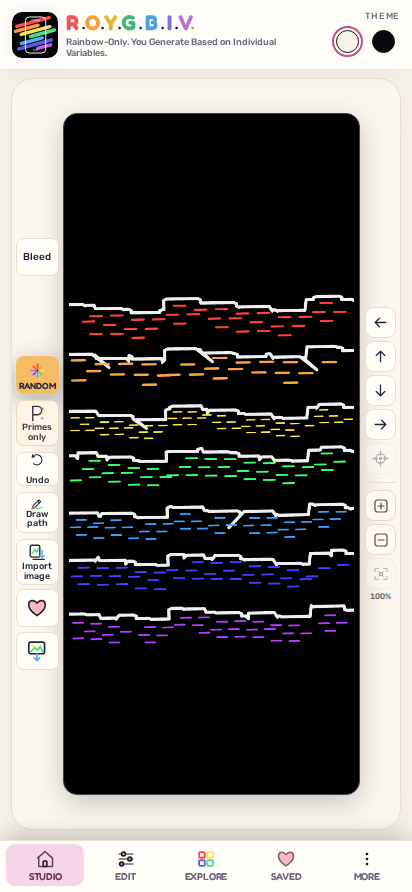 | 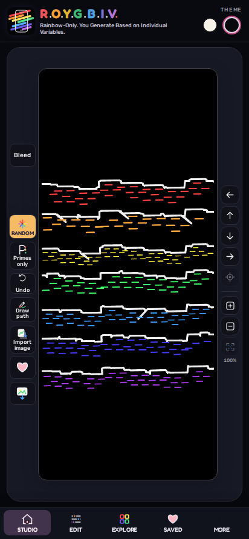 | [Original studio schematic](studio.svg) |
| geometry | 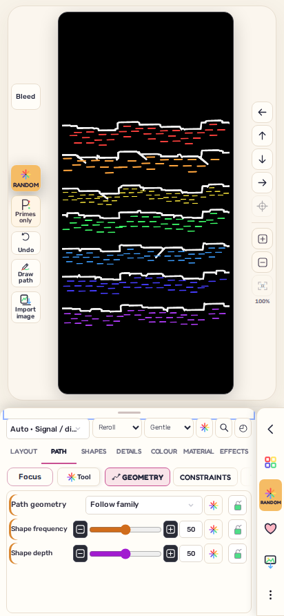 | 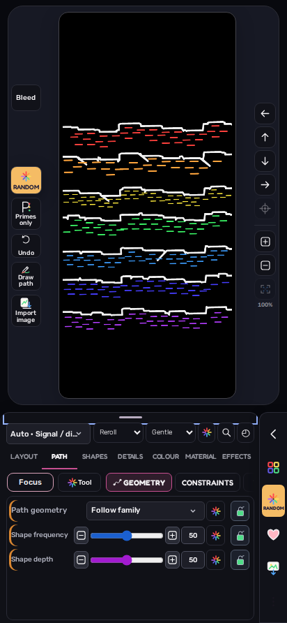 | [Original geometry schematic](geometry.svg) |
| draw | 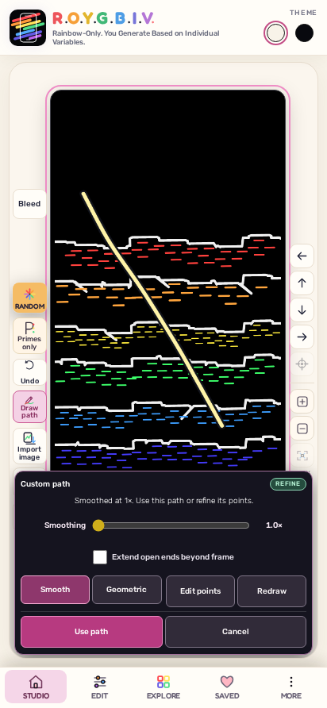 | 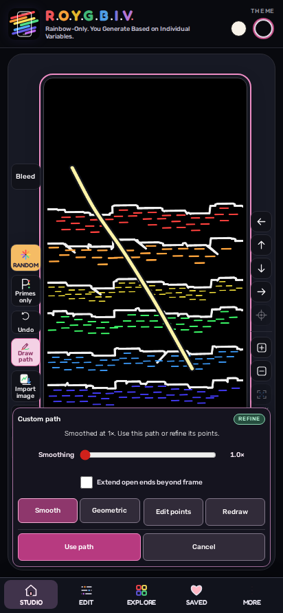 | [Original draw schematic](draw.svg) |
| explore | 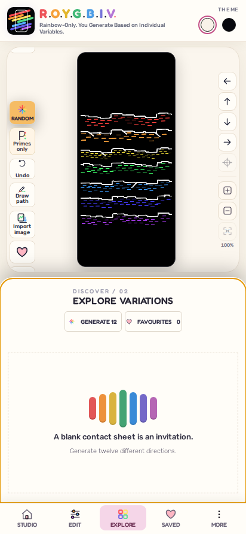 | 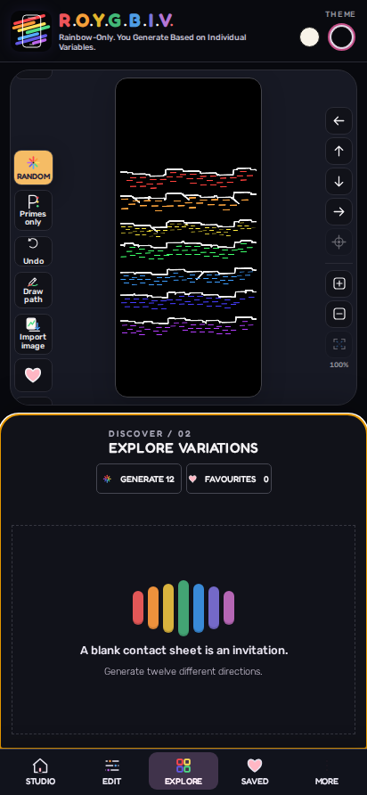 | [Original explore schematic](explore.svg) |
| more | 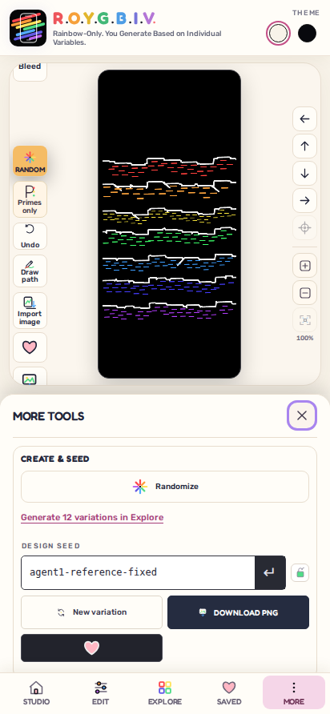 | 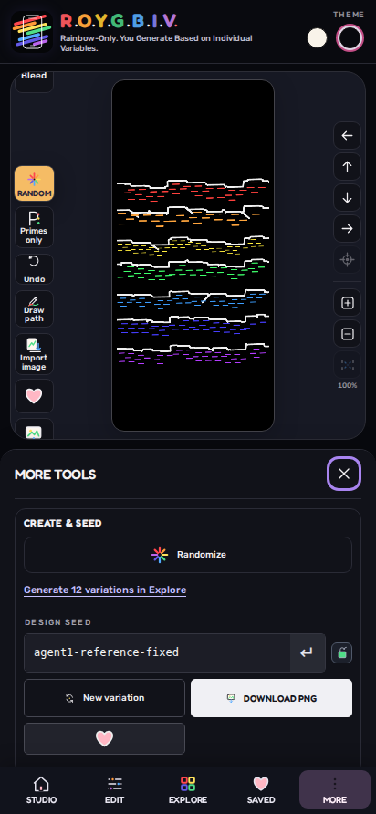 | [Original more schematic](more.svg) |
| material | 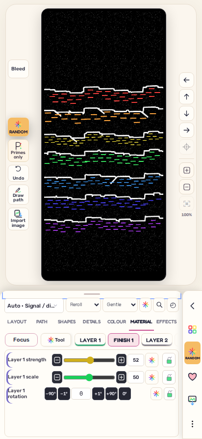 | 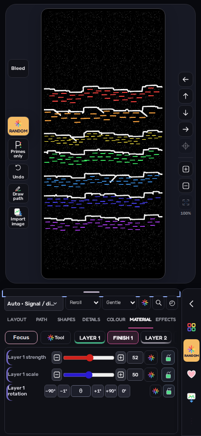 | [Original material schematic](material.svg) |
| colour | 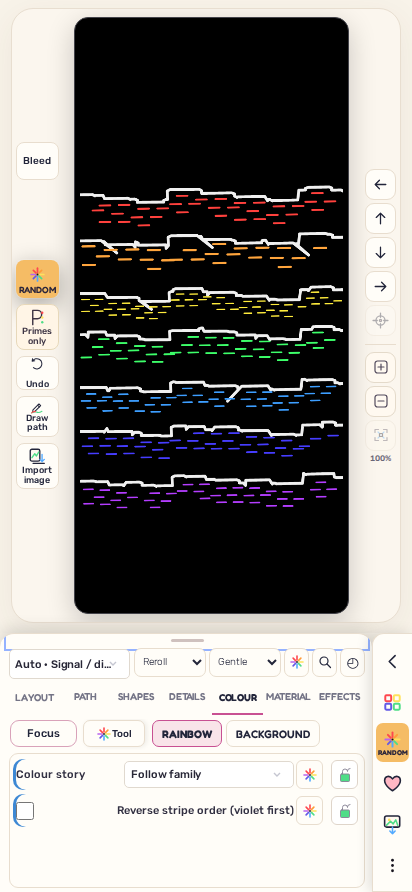 | 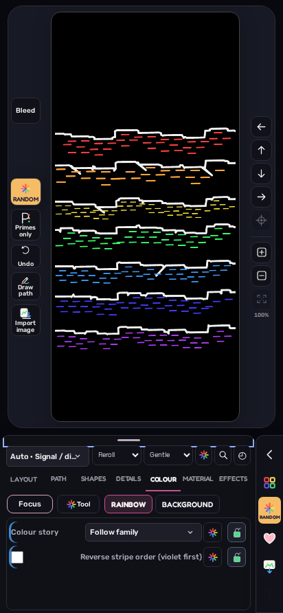 | [Original colour schematic](colour.svg) |
| diagonal | 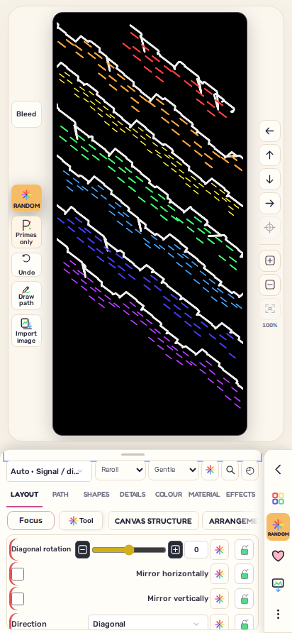 | 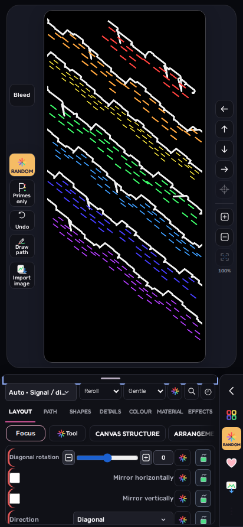 | [Original diagonal schematic](diagonal.svg) |
| compact | 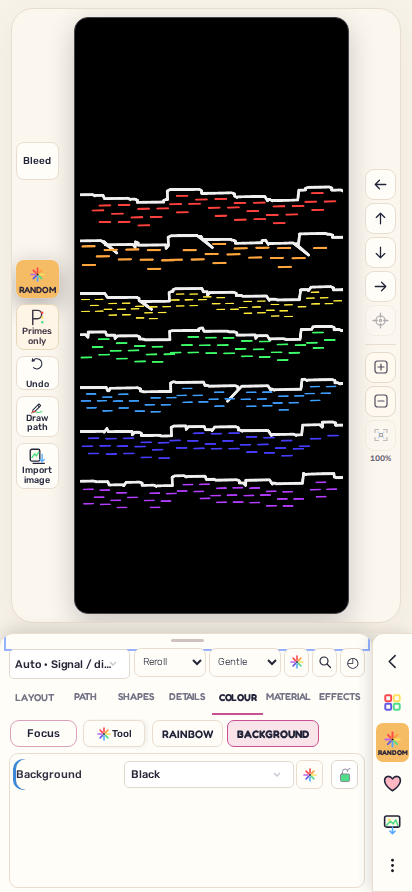 | 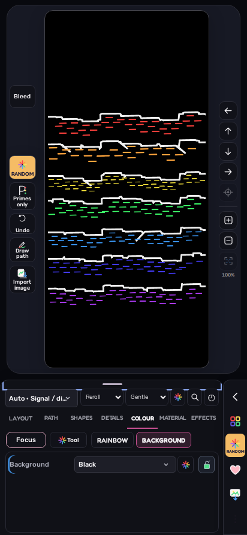 | [Original compact schematic](compact.svg) |
| focus | 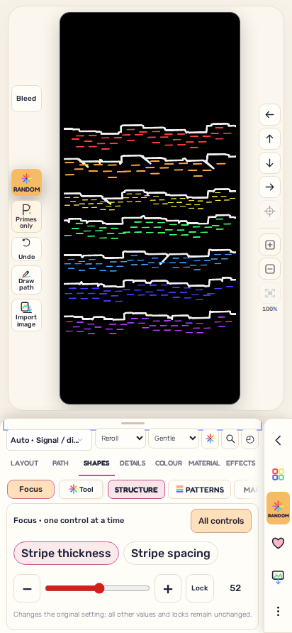 | 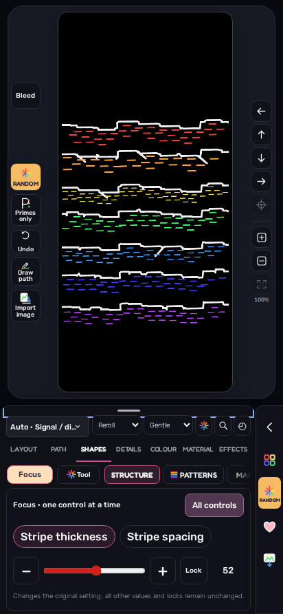 | [Original focus schematic](focus.svg) |
| history | 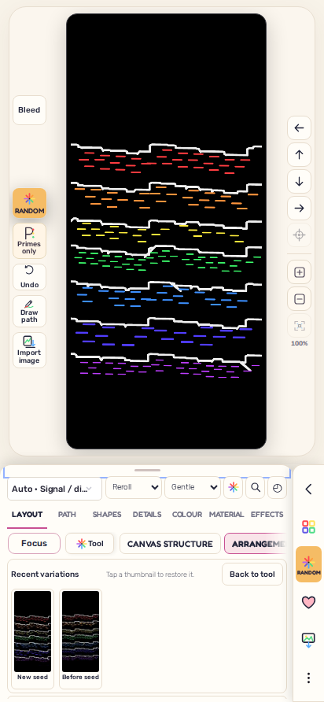 | 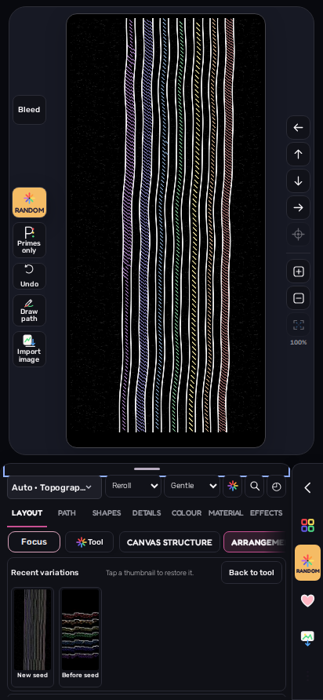 | [Original history schematic](history.svg) |
| search | 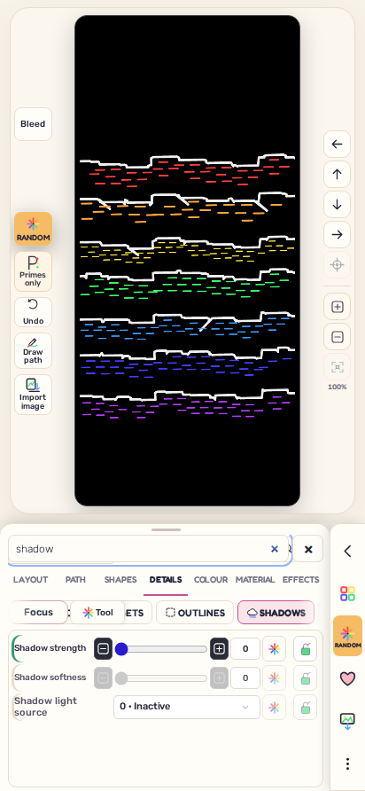 | 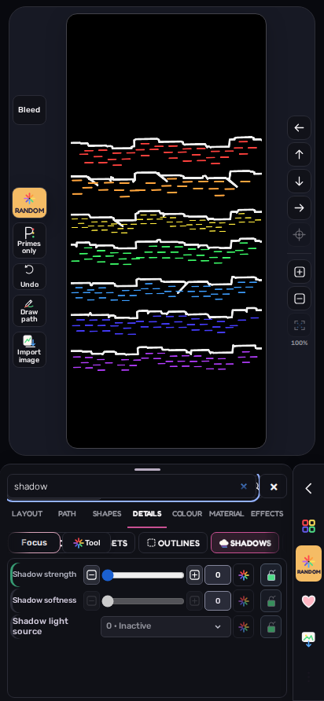 | [Original search schematic](search.svg) |

## Eight independent SVG candidate screenshots (still unwired)

### pan

Label View frame Pan and never composition nudge.

### anchor-points

Label Edit anchors; 20px node handles are small.

### smooth-path

Label Interpret / Resmooth; never claim a drawing pencil.

### extend-path

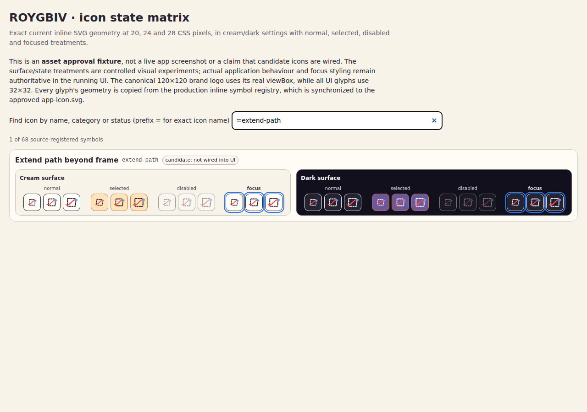

Dense at 20px; prefer 24px+ or adjacent text.

### weave

Add text for crossings/over/under; colour alone is insufficient.

### focus-slider

Explicit Focus label; do not replace the default All inspector.

### metadata

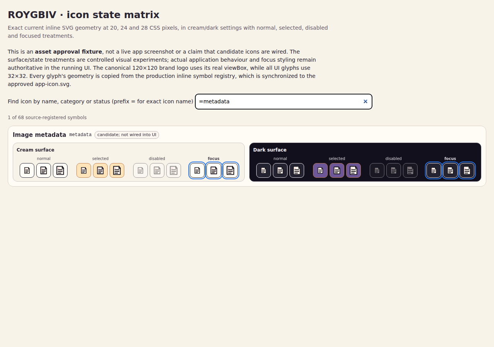

Corrected page outlines on dark surfaces; label Metadata.

### restore-variation

Label Restore; avoid conflating History and Undo.

## Boundaries

Optical evidence means these exact screenshots were inspected as real pixels. It does **not** claim human preferences, a physical Android test, or native assistive-technology speech. Candidate vectors remain unwired until individually mapped to their exact existing controls and their size/label restrictions are satisfied. Uncommon responsive/conditional states remain in the live CI artifact and source audit; do not confuse these 24 named 412px plates with exhaustive app certification.
